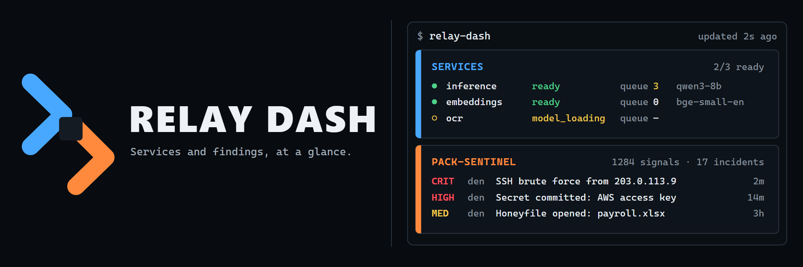

<p align="center">
  
</p>

Relay Dash is a terminal dashboard for the services we run. It shows open findings from [pack-sentinel](https://github.com/dispersal-wolves/pack-sentinel) next to the status of the impossibleG services: which models are loaded, how deep each request queue is, and whether every service is live and ready. It only reads; it never acknowledges incidents, runs collectors, or loads models.

## Try it

```sh
npm install
npm run dev
```

Press `q` to quit. To print one frame without opening the interactive screen:

```sh
npx tsx src/cli.tsx --snapshot
```

## Documentation

- [Architecture](./docs/architecture.md)
- [Artwork](./docs/assets/ARTWORK.md)
- [Contributing](./CONTRIBUTING.md)
- [Security](./SECURITY.md)

## Development

```sh
npm install
npm run check
```

`npm run check` verifies formatting, linting, strict types, tests, and the distributable package. Relay Dash requires Node.js 22 or newer.

## License

MIT
